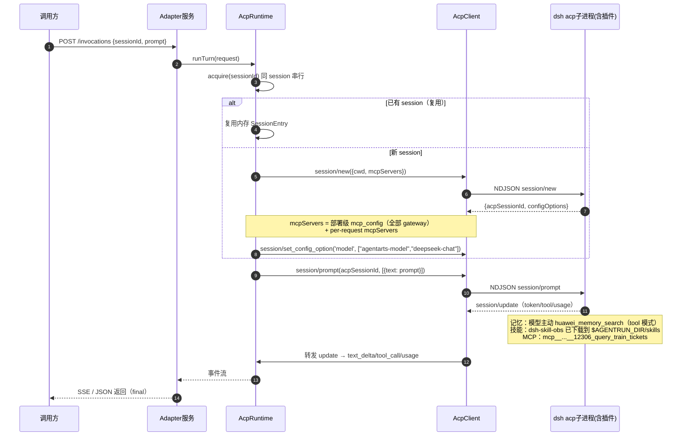

# ACP 集成说明（AgentArts Adapter × DSH ACP）

本文档描述 **ACP 路线**下 Adapter 与 DSH 的集成方式：以 `dsh acp` 常驻子进程替代旧的 headless 一次性进程，并将 AgentArts 的记忆与 OBS 技能两个插件挂载进来。

> 旧的 headless 路线（`dsh --profile agentrun` + 每轮一个子进程 + profile patch 渲染）已弃用，相关 CLI、`scheduler/resident.ts`、`patch.ts` 的动态渲染、demo 脚本均已移除。

## 1. 总体形态

```
平台（/invocations、/ws）
   │
   ▼
AgentArts Adapter 服务（主进程，runtime/dist/main.js）
   ├─ AgentArtsRuntimeApp（协议面）
   ├─ AcpRuntime（多 session 复用）
   └─ AcpClient ──spawn──► dsh acp 子进程（常驻，stdio JSON-RPC）
                              ├─ @deepseek-ai/dsh-acp-app（ACP profile bundle）
                              ├─ @agentarts/dsh-agentarts-memory（记忆插件）
                              └─ @agentarts/dsh-skill-obs（OBS 技能插件）
```

- **一个 `dsh acp` 子进程常驻**，多个 session 内存复用（不再有「每轮冷启动装配」）。
- 两个插件通过 **`DSH_HOME/profiles/acp/`**（`materializeProfile` 生成）挂载：`package.json` 的 bundles 含 `dsh-acp-app` + 两个插件，`vendor/` + `node_modules/` 提供依赖。

## 2. 部署步骤

### 2.1 环境变量

```cmd
REM agent_metadata（完整 JSON：model_config/memory_config/mcp_config/skills/user_bucket/system_prompt）
set "agent_metadata={...}"

REM OBS 签名与记忆数据面
set HUAWEICLOUD_SDK_AK=...
set HUAWEICLOUD_SDK_SK=...
set OBS_ENDPOINT=https://obs.cn-southwest-2.myhuaweicloud.com

REM 工作区与 DSH 可执行程序
set DSH_HOME=D:\temp\agentarts-demo-home
set AGENTRUN_DIR=D:\SB
set DSH_AGENT_CWD=D:\temp\agentarts-demo-work
set DSH_ACP_COMMAND=node
set DSH_ACP_ARGS=D:\temp\dsh-cli\node_modules\@deepseek-ai\dsh\lib\bin.js --profile acp
```

> `DSH_ACP_ARGS` 会**完全替换**默认参数，必须自己带上 `--profile acp`。

### 2.2 生成 acp profile（插件挂载的前提）

```cmd
node --input-type=module -e "import {loadAdapterConfig} from './adapter/dist/config.js'; import {materializeProfile} from './adapter/dist/patch.js'; materializeProfile(loadAdapterConfig())"
```

生成 `DSH_HOME/profiles/acp/`（含 `package.json`、`vendor/`、`node_modules/`、`cordis.patch.yml`）。

### 2.3 启动 ACP 服务

```cmd
node adapter/dist/main.js
```

启动流程：`bootstrapAcpFromAgentMetadata()`（`agent_metadata` → ACP env + identity 换模型/记忆 key）→ `loadConfig()` → `createDshApp()`。看到 `listening on 127.0.0.1:8080` 即就绪。

### 2.4 发请求（用 Node，避免 PowerShell GBK 编码问题）

```cmd
node -e "fetch('http://127.0.0.1:8080/invocations',{method:'POST',headers:{'content-type':'application/json'},body:JSON.stringify({sessionId:'demo-1',prompt:'我叫什么？另外，现在支持哪些 skill？',stream:false})}).then(r=>r.text()).then(t=>console.log(t))"
```

> **中文注意**：不要用 PowerShell 的 `Invoke-RestMethod` 直接发中文 body（GBK 编码会变成 `?`）。用 Node 的 `fetch`（默认 UTF-8）即可。

## 3. `agent_metadata` → ACP 配置映射

启动时由 `adapter/src/acp-config.ts` 完成翻译（只解析一次，缓存复用；配置变更才重新解析）：

| agent_metadata 字段 | ACP 消费方式 |
|---|---|
| `model_config.name` | `DSH_ACP_MODEL`（经 `applyModelConfig` 选中 `["agentarts-model","<name>"]`） |
| `system_prompt` | `DSH_SYSTEM_PROMPT` |
| `memory_config` | `DSH_ACP_CHILD_ENV` 内：`AGENTARTS_MEMORY_SPACE_ID`、`AGENTARTS_MEMORY_DATA_ENDPOINT`、`HUAWEICLOUD_SDK_MEMORY_API_KEY` |
| `skills` + `user_bucket` | `DSH_ACP_CHILD_ENV` 内：`agent_metadata`（原样 JSON）、`AGENTRUN_DIR`、`AGENTRUN_SKILLS`、`AGENTRUN_USER_BUCKET`、`OBS_ENDPOINT` 等 |
| `mcp_config`（数组）| `AGENTRUN_ACP_MCP_SERVERS`（**全部** gateway 转 `mcpServers`，见 §5） |
| 模型/记忆/MCP 的 `credential_provider_name` | 启动时经 `resolveCredentials`（identity 换 key）注入 `MODEL_API_KEY`、记忆 key、MCP headers |

**其他环境变量**（`HUAWEICLOUD_SDK_AK/SK`、`OBS_ENDPOINT`、`AGENTRUN_DIR`、`DEEPSEEK_API_KEY` 等）：ACP 的 `AcpClient` 用 `env: { ...process.env, ...acpEnv }` **全量继承** Adapter 进程环境，只要部署时注入 Adapter 容器环境即可，无需逐个白名单透传。

## 4. 一次请求的完整时序



## 5. 多 MCP gateway 支持

`agent_metadata.mcp_config` 是**数组**，每个元素一个 gateway。翻译层把**全部** gateway 转成 ACP `mcpServers`：

```
mcp_config[i] → { name: serverName, type: 'http', url: endpoint,
                  headers: [{name:'Authorization', value:'Bearer <key>'}] }
        ↓ 序列化为 AGENTRUN_ACP_MCP_SERVERS（JSON）
openSession 时 readDeployedMcpServers() 合并进 session/new 的 mcpServers
```

- 部署级（全部 gateway）与 per-request（`request.mcpServers`）会**合并**，几个 gateway 就挂几个。
- 不再渲染 `dsh-mcp-client` 插件行（headless 的方式），MCP 统一走 `session/new` 的 `mcpServers`。

## 6. 插件挂载

| 插件 | 职责 | 挂载方式 |
|---|---|---|
| `@agentarts/dsh-agentarts-memory` | 记忆召回（`huawei_memory_search` 查长期记忆）、`huawei_memory_save`（存短期记忆，平台自动提取长期记忆） | acp profile bundles + vendor；env 经 `DSH_ACP_CHILD_ENV` 注入 |
| `@agentarts/dsh-skill-obs` | 从 OBS 下载技能到 `<AGENTRUN_DIR>/skills` | 同上；`AGENTRUN_DIR` 为基目录，技能落 `<dir>/skills` |

**vendor 依赖落地**（`materializeHostPlugins` + `installProfileDependencies`）保留：插件依赖（`esdk-obs-nodejs`、`fflate`、`@huaweicloud/agentarts-sdk`）必须安装才能运行，且**依赖指纹未变时跳过重复安装**。

## 7. 验证清单

| 验证项 | 预期 |
|---|---|
| 模型路线 | `set_config_option` 为 `["agentarts-model","<model_name>"]`（不再回退 `deepseek-official`） |
| 记忆召回 | 模型主动调 `huawei_memory_search`，能答出记忆中的人名/项目代号 |
| OBS 技能 | `<AGENTRUN_DIR>/skills/` 下有 `json-processor/`、`markdown-formatter/`，模型能列出 |
| MCP | 能调 `mcp__<gateway>__12306_query_train_tickets` 返回真实车次 |
| 插件激活 | 无 `did not activate`、无 `JsonSchemaError` |

## 8. 与 headless 的关键差异

| 维度 | headless（已弃用） | ACP（当前） |
|---|---|---|
| 进程模型 | 每轮一个子进程 | **一个常驻子进程，多 session 复用** |
| 配置注入 | profile patch 渲染 + `buildChildEnv` 白名单 | `agent_metadata` → `DSH_ACP_CHILD_ENV`（全量继承 + JSON 覆盖） |
| MCP | `dsh-mcp-client` 行（profile patch） | `session/new` 的 `mcpServers`（per-session，多 gateway） |
| 模型选择 | `agent-default-model` provider | `applyModelConfig` 按 group 嵌套匹配 configOptions |
| 记忆召回 | 插件 `agent/pre-step` | 同（tool 模式模型主动 search，或 auto 自动注入） |
| 启动器 | `scheduler/run.ts` 的 `spawnCaptured` | `runtime/acp-client.ts` 的 `AcpClient` |
